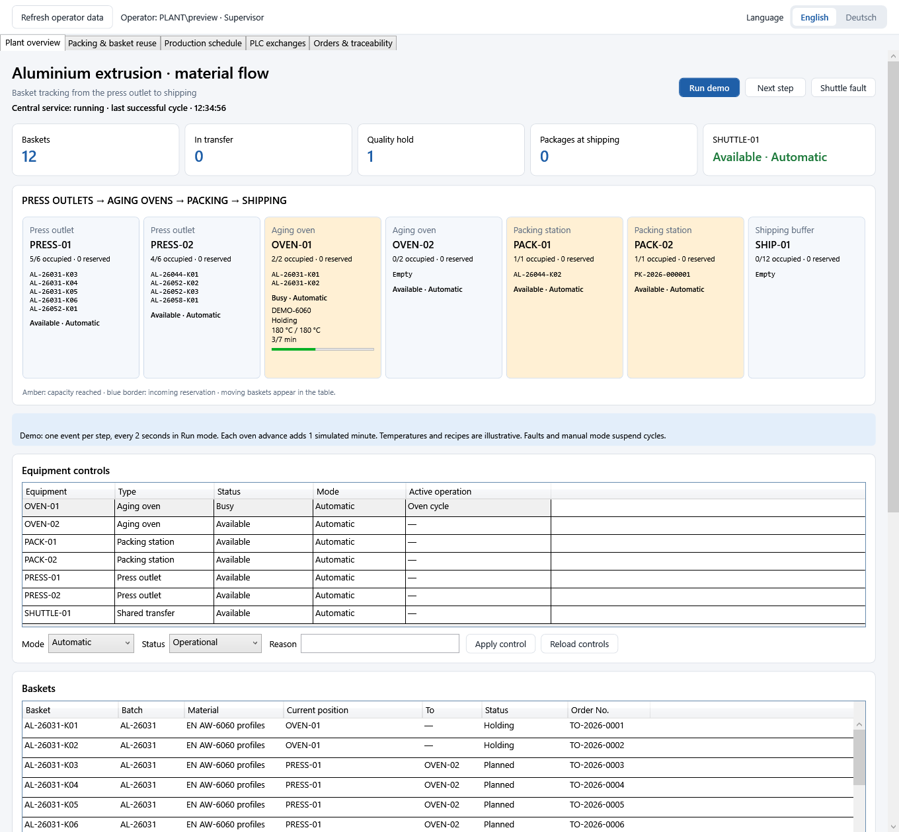

# TransportOrders

**Release build:** [repeatable verification and API/client packaging](docs/release-baseline.en.md).

**Documentation:** [technical reference and user manuals in English, German and French](docs/handbook/README.md), with maintained Markdown and printable PDFs.

**Simulation oven recipes:** [operator workflow and upgrade guide](docs/oven-recipes.fr.md). Supervisors create and validate versioned drafts; running oven cycles retain the original parameters and revision. Latest packages: `artifacts/recipes-api` and `artifacts/recipes-client`.

**German guided demo:** [MP4 with German narration](output/video/TransportOrders-Demo-DE.mp4), [subtitles](output/video/TransportOrders-Demo-DE.srt), and [generation notes](output/video/README.de.md). Uses the original WPF views and an isolated simulation database.

[](https://github.com/Lassoued1/TransportOrders/actions/workflows/ci.yml)

A WPF material-flow demonstrator for **aluminium extrusion**: loaded baskets move from press outlets
through aging ovens to packing. Checked packages go to shipping and empty baskets return to the presses.
An ASP.NET Core API exposes persisted orders, positions and history, and accepts authenticated equipment controls.

The API can also host the central demo driver, independently of WPF:

```powershell
dotnet run --project src/TransportOrders.Api -- --Runtime:Enabled=true --urls=http://localhost:5080
```

Keep this process running to continue PLC polling and simulated production after closing WPF.
Supervisors can [pause/resume the central simulation](docs/runtime-controls.en.md)
from Plant overview; the pause survives service restarts and is audited.
`/api/runtime` reports its state. Automatic scheduling has one owner per database;
WPF refreshes the shared state while the service owns it. See the [central service guide](docs/central-service.fr.md)
for restart behavior and the current local, simulated scope.
Windows automatic startup, LocalService permissions and installation scripts are described in the
[Windows service guide](docs/windows-service.fr.md).
Equipment mode/condition changes from WPF use the service API with Windows authentication,
an operator allowlist and version conflicts. See the [equipment commands guide](docs/equipment-api.fr.md).
Quality, baskets, orders, manual transfers and PLC operator actions also use the API.
See the [central operator commands guide](docs/operator-commands.fr.md).
Quality, logistics, maintenance and supervisor roles govern each action. WPF shows the authenticated
account and effective roles, and disables unauthorized commands. See the [operator roles guide](docs/operator-roles.fr.md).

The plant overview shows basket locations, occupied slots and incoming reservations. A step-by-step or
automatic simulator acknowledges transfers and processing; each new leg becomes an audited transport
order. This is an independent learning project inspired by publicly described MCVIS material-flow concepts.



## Try the extrusion scenario

1. Run the desktop app; **Plant overview** is the first tab.
2. Click **Next step** to acknowledge the initial shuttle arrival, then complete processing and dispatch
   subsequent legs. Ovens run heating, holding and cooling before baskets can leave.
   **Run demo** advances one event every two seconds; an oven event adds one simulated minute.
   When the central runtime is active, it advances the scenario itself and the desktop
   step/run buttons are disabled. Use the Supervisor central pause/resume control instead.
3. Inject a **Shuttle fault** during a transfer. The destination remains reserved until recovery.
4. Pause and open **Orders & traceability** to inspect history or release the basket on quality hold.
5. Resume: ten checked packages reach shipping and ten empty baskets return to the presses;
   releasing the held basket allows an eleventh to finish.
   The cancelled basket remains at the press outlet.
6. Select an oven in **Equipment controls**, choose fault, maintenance or manual mode, enter a reason,
   and apply. Its cycle suspends and survives a restart. Restore operational/automatic mode to resume.
7. Open **Packing & basket reuse** to inspect package labels, record a quality rejection, or reload
   a returned empty basket. Each reload creates a new load sequence and press-to-oven order.
8. Open **Production schedule** to see the next action, compatible oven admissions and blocking reasons.
   The simulator executes the same plan and recalculates it after every event.
9. Open **PLC exchanges** to suppress replies or disconnect the demo channel. A timeout retains the
   transfer reservation; explicit retries reuse the same command id. Restore reply delivery to receive a late acknowledgement.

See the [French scenario guide](docs/extrusion-scenario.fr.md) for the model, limits and demo steps.
See the [PLC exchange guide (French)](docs/plc-exchanges.fr.md) for reply loss, timeouts and recovery.

## Features

- **Persistent plant model.** `Basket`, `MaterialLot` and `PlantLocation` have their own tables.
  Physical positions are independent of transport orders. Dispatch and arrival update positions,
  reservations, transports and audit history atomically; stale orders and overbooked destinations are rejected.
  An additive migration imports existing baskets once without replacing order history.
- **Plant overview.** Two press outlets, two aging ovens (two basket slots each), two packing stations
  (one slot each), and a shipping buffer. Moving baskets reserve their destination and occupy the shared
  transfer resource. Capacity is checked by the simulator and by manual dispatch from the orders tab.
- **Simulated process flow.** Press → oven → packing → shipping. Basket identity and material batch stay
  unchanged across transport legs. Compatible whole oven batches use persisted recipe snapshots,
  heating/holding/cooling phases and simulated temperatures. Completed oven treatment generates a packing order.
- **Packing and reuse.** One basket load becomes one package. Visual and quantity checks gate the label,
  unloading and package shipping. Rejected packages need explicit reinspection. Empty baskets return
  through audited, reserved transfers, then can be reloaded with another batch. Package snapshots and
  previous treatment histories survive reuse; old cycles cannot validate a new load.
- **Equipment controls.** Persisted modes, faults, maintenance and active operations with an audit trail.
  A fault or manual mode suspends simulated processing; early unloading and incompatible oven loading are rejected by the repository.
- **Production scheduling.** A shared read-only scheduler ranks acknowledgements, downstream clearance,
  compatible oven loads and treatment progress. Urgency and due times choose the alloy group admitted
  to each oven. Normal partial loads wait for an eligible compatible follower; urgent partial loads can start.
  The UI and API expose candidates and blocking reasons; the simulator executes the first eligible action.
- **Durable PLC exchange.** Transfer reservation and command outbox are committed together.
  A persistent demo channel, validated acknowledgement inbox, stable identifiers and retry limits handle
  reply loss and restart. Arrival is applied atomically once; acceptance alone is insufficient.
  Physically verified manual arrivals are recorded separately from machine acknowledgements.
- **Full loads only.** A transport must use at least **90 % of the vehicle's loading length**. It can never
  leave empty, carry two routes, or exceed the loading length or the payload. A part load is only possible with
  a recorded reason (urgent material, payload limit reached, end of shift, no matching material).
- **Load planning.** *Plan loads* groups the waiting orders into proposals per route: urgent and overdue
  orders first, then the combination that fills the vehicle best (a knapsack on loading length that respects the
  payload). The dispatcher dispatches a proposal with one click; the plan is recalculated after each dispatch.
- **Quality hold.** Material can be put *on hold* with a mandatory reason and released later; held material is
  never planned.
- **Traceability.** Every order carries a material batch and basket identifier, e.g. `AL-26031-K01`
  from billet batch `AL-26031-B01`. *Trace batch* filters the movements; *Genealogy* groups the baskets
  by their billet batches. Each status change records user, time and note.
- **Priorities, due times and shift figures:** urgent orders are flagged, overdue ones shown in red; the
  current shift (Early 06–14, Late 14–22, Night 22–06) shows trips, average fill, part loads, completed orders,
  average transit time, open, overdue, urgent and held orders.
- **Barcode scan field**, **English / German** UI switchable at runtime, **Serilog** log files, clear error
  messages with rollback by reloading from the database, UI that stays responsive.

| Shortcut | Action |
| --- | --- |
| `Ctrl+F` | Focus the search box |
| `Esc` (in search) | Clear the search |
| `F5` | Reload orders from the database |
| `Alt+P` / `Alt+H`, `Alt+R` / `Alt+C` / `Alt+N` | Plan loads / Hold, Release / Complete / Cancel (German UI: `Alt+P` / `Alt+S`, `Alt+F` / `Alt+A` / `Alt+O`) |

## Rules

```
Planned ──(loaded on a transport)──▶ InTransit ──(transport arrives)──▶ Done
  │  ▲                                    │
Hold│  │Release                              │
  ▼  │                                    ▼
OnHold ─────────────────────────────▶ Cancelled ◀── Planned
```

- An order only reaches **InTransit** through `Transport.Dispatch`; the full-load rule lives there, so neither the
  UI nor the API can bypass it. Completing a transport marks all of its orders **Done**.
- **OnHold** needs a reason; **Done** and **Cancelled** are final. Invalid transitions throw an exception naming
  both statuses, and nothing is recorded.
- Extrusion equipment (demo values): basket shuttle 7 m / 4 t, overhead crane 14 m / 8 t.
  The simulator moves one basket at a time; manual planning can group baskets on the crane.
  The full-load threshold is one constant: `Transport.FullLoadThreshold`.

## Technologies

.NET 8, C#, WPF, CommunityToolkit.Mvvm, Entity Framework Core 8 with SQLite (migrations),
ASP.NET Core minimal APIs with Swagger, Microsoft.Extensions.DependencyInjection, Serilog, xUnit,
GitHub Actions.

## Solution structure

| Project | Content |
| --- | --- |
| `src/TransportOrders.Core` | Domain: `TransportOrder`, `Transport`, `LoadPlanner`, `ExtrusionPlant`, `ExtrusionSimulator`, genealogy and shifts. No WPF, EF Core or SQLite reference. |
| `src/TransportOrders.Data` | `AppDbContext`, EF Core repository, migrations, database initialization and demo data. References Core. |
| `src/TransportOrders.App` | WPF API client: `MainWindow`, dialogs, view models, localization and DI. References Core; no direct SQLite access. |
| `src/TransportOrders.Api` | ASP.NET Core reads, authenticated operator commands and background services. References Core and Data. |
| `tests/TransportOrders.Tests` | Domain tests: transitions, loading rules, load planner (including a randomized invariant test), oven phases and compatibility, equipment recovery, genealogy, shifts. References Core only. |
| `tests/TransportOrders.App.Tests` | View-model behavior and a real WPF dashboard layout/render check. |
| `tests/TransportOrders.IntegrationTests` | Repository, API and complete extrusion-flow tests against temporary SQLite files, including reservation limits, fault recovery and restart behavior. |

## Prerequisites

- Windows 10 or 11
- [.NET 8 SDK](https://dotnet.microsoft.com/download/dotnet/8.0)

## Build, test and run

```powershell
dotnet restore TransportOrders.sln
dotnet build TransportOrders.sln
dotnet test TransportOrders.sln
```

Start the API before the client. Do not start a second listener on port 5080 if the installed service already uses it. For a local development demo with the current account authorized:

```powershell
$demoOperator = [Security.Principal.WindowsIdentity]::GetCurrent().Name
dotnet run --project src/TransportOrders.Api -- --Access:UseRoles=true --Access:Roles:Supervisor:Users:0="$demoOperator" --Runtime:Enabled=false --urls=http://localhost:5080
```

In another shell, run `dotnet run --project src/TransportOrders.App`. Swagger is available in Development only.

```powershell
dotnet run --project src/TransportOrders.App
```

## API

The API owns domain mutations; WPF submits authenticated, authorized commands. The load-plan endpoint
only calculates proposals. Business reads require Windows authentication; enums are returned as text.

| Endpoint | Returns |
| --- | --- |
| `GET /api/orders?status=&heat=&overdue=` | Orders, optionally filtered (`400` for an unknown status) |
| `GET /api/orders/{id}` | One order with its history (`404` if unknown) |
| `GET /api/orders/{id}/history` | The order's audit trail |
| `GET /api/orders/by-number/{orderNumber}` | Case-insensitive lookup, e.g. from a scanned barcode |
| `GET /api/transports` | Transports with fill rate and any part-load reason |
| `GET /api/load-plan` | Proposed full loads for the waiting orders (calculation only) |
| `GET /api/plant` | Basket positions, lots, capacities, equipment/history, recipes, cycles, packages and empty returns |
| `POST /api/equipment/{id}/control` | Windows-authenticated, authorized equipment mode/condition change with reason and expected version |
| `GET /api/packages/{number}/label` | Approved package label as printable text; 404 before approval or for an unknown package |
| `GET /api/schedule` | Next action, ranked eligible alternatives, batch recipes and current blocking reasons |
| `GET /api/plc` | Durable command envelopes, acknowledgement states, attempts, deadlines and audit history |
| `GET /api/heats/{heatNumber}/genealogy` | Everything made from one heat, as a tree |
| `GET /api/shift-summary` | Figures of the current shift in the plant time zone (`Plant:TimeZone`) |
| `GET /health` | Health check |

```powershell
Invoke-RestMethod 'http://localhost:5080/api/load-plan' -UseDefaultCredentials
```

## Data storage

- Server SQLite database: explicit `Database:Path`; the installed example uses `C:\ProgramData\TransportOrders\extrusion.db`.
  Development fallback paths are selected by `DatabasePaths`. WPF reads and writes through the API.
- The previous `transportorders.db` is left untouched. The new filename starts a separate extrusion
  scenario instead of rewriting existing steel orders.
- The schema is managed with **EF Core migrations**, applied at start-up.
  - Historical compatibility remains: a version 1 database (`EnsureCreated`) is backed up and replaced.
  - The historical `SteelPlantTransports` migration clears version 2 demo orders. It is retained unchanged;
    do not point the new application at an operational legacy database expecting a lossless conversion.
- The demo data (12 orders, 2 transports) is inserted only when the database contains no order, with times
  relative to the first launch, so restarting never duplicates it or resets changes. Delete the file to start again.
- Client preferences and logs: `%LOCALAPPDATA%\TransportOrders.Client\settings.json` and `logs\app-<date>.log`.

For schema compatibility, the code/API field `HeatNumber` carries the material batch, `PieceNumber` the
physical basket identity and `ParentPieceNumber` its billet batch. `BasketContentSequence` identifies
each load independently of basket reuse. An empty basket exposes no current lot, while retaining its
last lot and history. One load has one material lot and becomes one package; split or mixed loads remain future work.

The additive `PersistedPlantModel`, `EquipmentAndOvenCycles`, `PackingAndReusableBaskets` and `DurablePlcExchange` migrations preserve existing extrusion
orders, history and positions. Equipment is initialized once, preserving any active shared transfer.

All desktop reads and plant mutations use the authenticated API.
The central service owns migrations, demo seeding and operator writes; Commissioning initializes schema only.
The central runtime owns automatic scheduling while active. Desktop run mode is paused on restart.
Movement history, reservations, equipment controls and oven progress are recovered from SQLite.
Oven recipe settings and temperature interpolation are illustrative. Each oven advance adds one simulated
minute; wall time during shutdown never advances treatment. Several oven cycles can be active;
one event advances one oven, choosing the least advanced active cycle. Each event replans the next action.
Packing preparation and automatic QA checks are simulated. Labels are printable text, without an
integrated label printer or graphical barcode. Reload quantities are operator-entered demo values,
without a material-stock reservation. PLC exchanges currently use a persistent simulator; no live machine
protocol is connected. There are no approved production recipes
or safety controls. The generic load plan calculates fit; actual dispatch checks equipment availability,
capacity, alloy compatibility and completed cooling.

To add a migration: `dotnet tool restore`, then
`dotnet ef migrations add <Name> --project src/TransportOrders.Data --startup-project src/TransportOrders.Data`.

## MCVIS context and technical alignment

The [MCVIS technical comparison (French)](docs/mcvis-technical-alignment.fr.md) connects this project's
implementation to Böhler Steuerungen's public product descriptions and .NET job requirements. It includes
all six reference links, code pointers, current gaps, and a proposed development roadmap.

TransportOrders is an independent learning project. The comparison describes transferable concepts;
it does not establish compatibility with MCVIS or knowledge of its internal implementation.

## Possible next steps

- **ERP/MES integration** (e.g. SAP): orders would come from the ERP through a service behind
  `IOrderRepository`, or a write endpoint that calls the same domain methods.
- **Several dispatchers at once**: SQL Server instead of SQLite, optimistic concurrency with a row version,
  and a conflict message when two people plan the same order.
- **Live machine adapter** for an agreed PLC protocol, replacing the persistent demo channel and reconciling physical machine state.
- **Central exchange service** to process the outbox and incoming events independently of the desktop app.
- **Advanced scheduling**: production-order deadlines, route reassignment, forecasts and configurable optimization policies.
- **Advanced packing**: split/mixed packages, stock reservations and label-printer integration.
- **Industrial oven control**: validated recipes, measured temperatures, parallel scheduling and incident recovery.
- **Quality records** linked to material batches and loaded baskets.
- **Authentication** for the API and roles in the app (planning, dispatch, quality assurance).
# Postes opérateur réseau

Le client WPF consulte maintenant le service central sans accéder à SQLite. Voir [la configuration des postes et HTTPS](docs/network-clients.fr.md).

La [sauvegarde et restauration](docs/backup-restore.fr.md) conserve une copie SQLite contrôlée avec les commandes PLC persistantes. La [recette de reprise](docs/runtime-recovery.fr.md) teste les interruptions brutales sur une installation isolée.

Les [alarmes](docs/alarms.fr.md) disposent d’un historique et d’acquittements centralisés. Le [profil de mise en service](docs/commissioning.fr.md) prépare le raccordement réel sans générer de données de démonstration ni activer de commandes.
