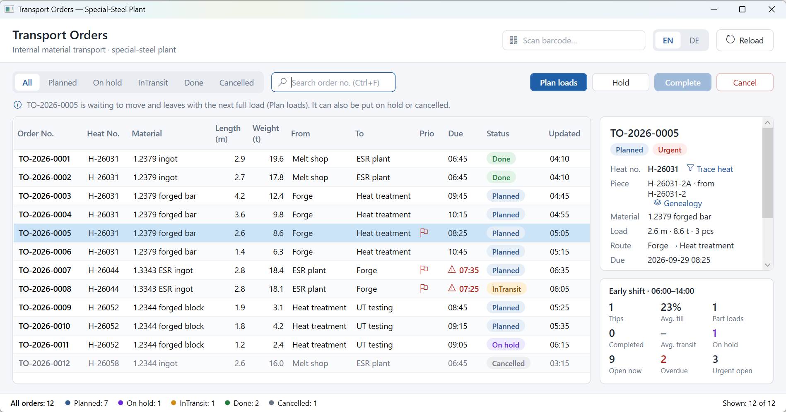
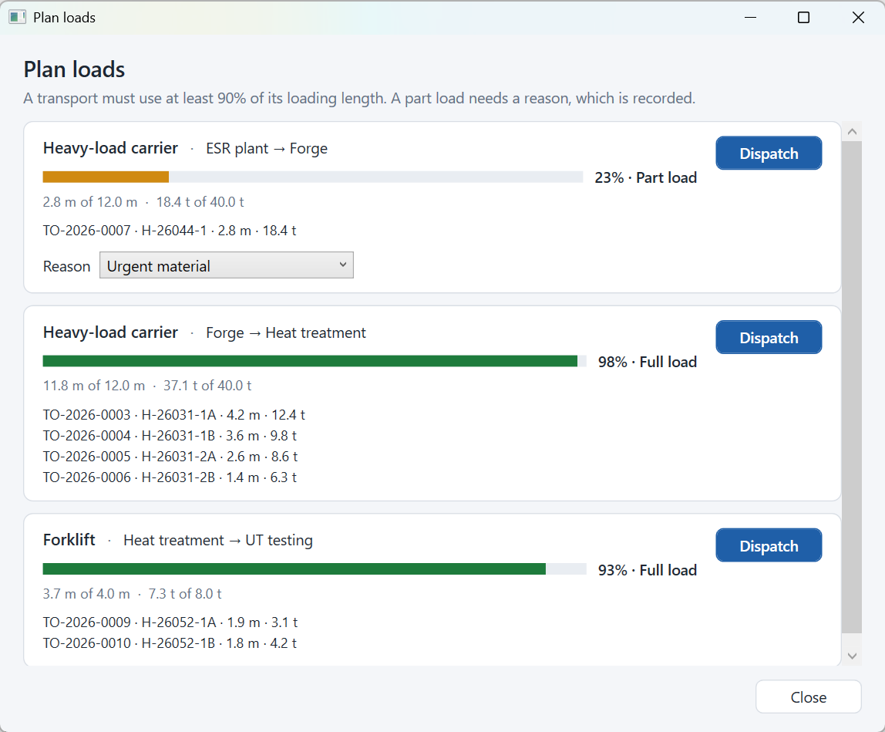
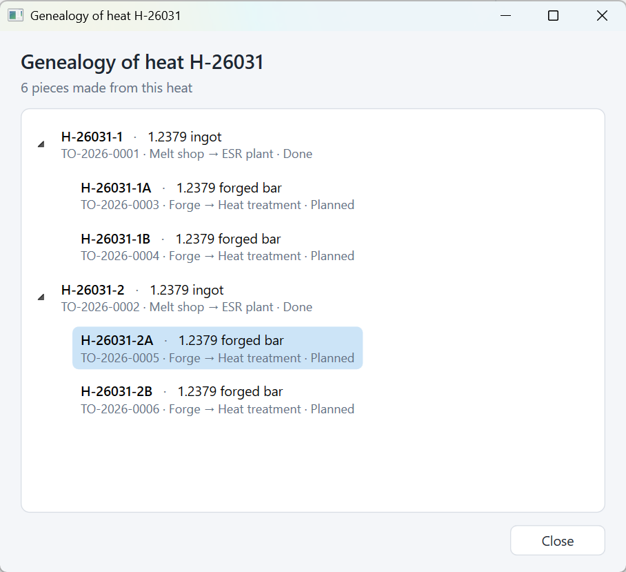
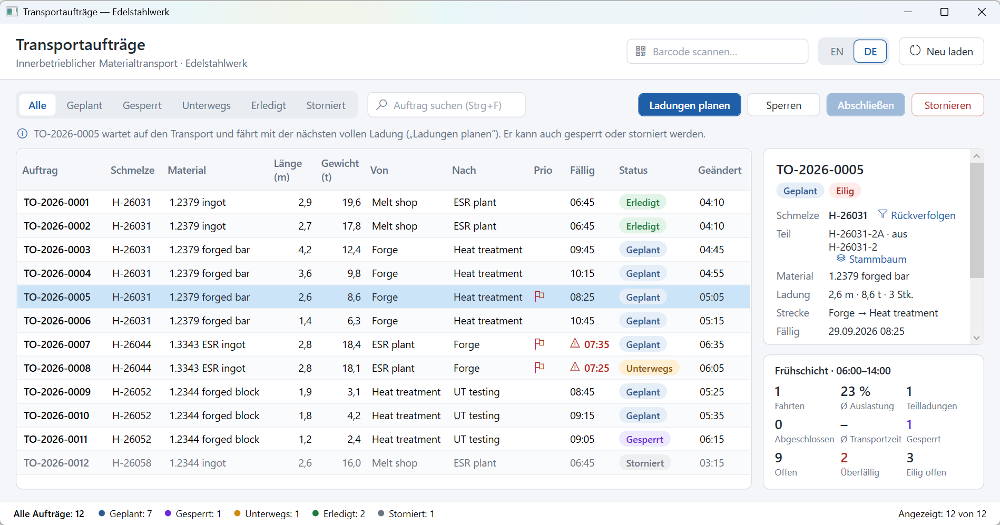

# TransportOrders

[](https://github.com/Lassoued1/TransportOrders/actions/workflows/ci.yml)

A WPF desktop application for internal transport orders in a special-steel plant (melt shop, ESR remelting,
forge, heat treatment, ultrasonic testing), with a small read-only ASP.NET Core API over the same domain
and data layer. Built as a WPF warm-up project.

Orders move ingots, forged bars and blocks between stations. They never travel alone: the dispatcher groups
them into **full loads** on a vehicle, material blocked by quality assurance cannot be loaded, and every
movement is traceable to the heat (melt) it comes from and to the person who made it.



## Features

- **Full loads only.** A transport must use at least **90 % of the vehicle's loading length**. It can never
  leave empty, carry two routes, or exceed the loading length or the payload. A part load is only possible with
  a recorded reason (urgent material, payload limit reached, end of shift, no matching material).
- **Load planning.** *Plan loads* groups the waiting orders into proposals per route: urgent and overdue
  orders first, then the combination that fills the vehicle best (a knapsack on loading length that respects the
  payload). The dispatcher dispatches a proposal with one click; the plan is recalculated after each dispatch.
- **Quality hold.** Material can be put *on hold* with a mandatory reason and released later; held material is
  never planned.
- **Traceability.** Every order carries its heat and piece number (e.g. bar `H-26031-1A` forged from ingot
  `H-26031-1`). *Trace heat* filters all orders of a melt; *Genealogy* shows the heat as a tree. Each status
  change is recorded with user, time and note (hold reason, transport number).
- **Priorities, due times and shift figures:** urgent orders are flagged, overdue ones shown in red; the
  current shift (Early 06–14, Late 14–22, Night 22–06) shows trips, average fill, part loads, completed orders,
  average transit time, open, overdue, urgent and held orders.
- **Barcode scan field**, **English / German** UI switchable at runtime, **Serilog** log files, clear error
  messages with rollback by reloading from the database, UI that stays responsive.

| Load planning | Genealogy of a heat |
| --- | --- |
|  |  |



| Shortcut | Action |
| --- | --- |
| `Ctrl+F` | Focus the search box |
| `Esc` (in search) | Clear the search |
| `F5` | Reload orders from the database |
| `Alt+P` / `Alt+H`, `Alt+R` / `Alt+C` / `Alt+N` | Plan loads / Hold, Release / Complete / Cancel (German UI: `Alt+P` / `Alt+S`, `Alt+F` / `Alt+A` / `Alt+O`) |

## Rules

```
Planned ──(loaded on a transport)──▶ InTransit ──(transport arrives)──▶ Done
  │  ▲                                    │
Hold│  │Release                              │
  ▼  │                                    ▼
OnHold ─────────────────────────────▶ Cancelled ◀── Planned
```

- An order only reaches **InTransit** through `Transport.Dispatch`; the full-load rule lives there, so neither the
  UI nor the API can bypass it. Completing a transport marks all of its orders **Done**.
- **OnHold** needs a reason; **Done** and **Cancelled** are final. Invalid transitions throw an exception naming
  both statuses, and nothing is recorded.
- Vehicles (demo values): forklift 4 m / 8 t, heavy-load carrier 12 m / 40 t, rail wagon 18 m / 60 t.
  The full-load threshold is one constant: `Transport.FullLoadThreshold`.

## Technologies

.NET 8, C#, WPF, CommunityToolkit.Mvvm, Entity Framework Core 8 with SQLite (migrations),
ASP.NET Core minimal APIs with Swagger, Microsoft.Extensions.DependencyInjection, Serilog, xUnit,
GitHub Actions.

## Solution structure

| Project | Content |
| --- | --- |
| `src/TransportOrders.Core` | Domain: `TransportOrder`, `Transport` (loading rules), `LoadPlanner`, `HeatGenealogy`, `ShiftSummary`, `IOrderRepository`. No WPF, EF Core or SQLite reference. |
| `src/TransportOrders.Data` | `AppDbContext`, EF Core repository, migrations, database initialization and demo data. References Core. |
| `src/TransportOrders.App` | WPF app: `MainWindow`, dialogs, `MainViewModel` (no WPF dependency), localization, DI setup in `App.xaml.cs`. References Core and Data. |
| `src/TransportOrders.Api` | Read-only ASP.NET Core minimal API. References Core and Data. |
| `tests/TransportOrders.Tests` | 62 domain tests: transitions, loading rules, load planner (including a randomized invariant test), genealogy, shifts. References Core only. |
| `tests/TransportOrders.App.Tests` | 15 `MainViewModel` tests with a fake repository, clock and dialogs. |
| `tests/TransportOrders.IntegrationTests` | 27 repository and API tests against real temporary SQLite files, including the database upgrade. |

## Prerequisites

- Windows 10 or 11
- [.NET 8 SDK](https://dotnet.microsoft.com/download/dotnet/8.0)

## Build, test and run

```bash
dotnet restore TransportOrders.sln
dotnet build TransportOrders.sln
dotnet test TransportOrders.sln
dotnet run --project src/TransportOrders.App
```

Run the API (Swagger UI at http://localhost:5080/swagger):

```bash
dotnet run --project src/TransportOrders.Api
```

## API

Read-only on purpose: orders are dispatched, held and completed in the desktop app, where the domain rules
apply. The load plan endpoint only calculates proposals. Enums are returned as text.

| Endpoint | Returns |
| --- | --- |
| `GET /api/orders?status=&heat=&overdue=` | Orders, optionally filtered (`400` for an unknown status) |
| `GET /api/orders/{id}` | One order with its history (`404` if unknown) |
| `GET /api/orders/{id}/history` | The order's audit trail |
| `GET /api/orders/by-number/{orderNumber}` | Case-insensitive lookup, e.g. from a scanned barcode |
| `GET /api/transports` | Transports with fill rate and any part-load reason |
| `GET /api/load-plan` | Proposed full loads for the waiting orders (calculation only) |
| `GET /api/heats/{heatNumber}/genealogy` | Everything made from one heat, as a tree |
| `GET /api/shift-summary` | Figures of the current shift in the plant time zone (`Plant:TimeZone`) |
| `GET /health` | Health check |

```bash
curl "http://localhost:5080/api/load-plan"
```

## Data storage

- SQLite database: `%LOCALAPPDATA%\TransportOrders\transportorders.db`, shared by the app and the API
  (override the API's path with `Database:Path`). The folder is created on start-up.
- The schema is managed with **EF Core migrations**, applied at start-up.
  - A database from version 1 (created with `EnsureCreated`) is kept as `transportorders.db.v1-<timestamp>.bak` and replaced.
  - A database from version 2 (aluminium demo data) is migrated; its demo orders cannot be converted to steel
    pieces, so they are replaced by the new demo data.
- The demo data (12 orders, 2 transports) is inserted only when the database contains no order, with times
  relative to the first launch, so restarting never duplicates it or resets changes. Delete the file to start again.
- Also in that folder: `settings.json` (UI language) and `logs\app-<date>.log`.

To add a migration: `dotnet tool restore`, then
`dotnet ef migrations add <Name> --project src/TransportOrders.Data --startup-project src/TransportOrders.Data`.

## Possible next steps

- **ERP/MES integration** (e.g. SAP): orders would come from the ERP through a service behind
  `IOrderRepository`, or a write endpoint that calls the same domain methods.
- **Several dispatchers at once**: SQL Server instead of SQLite, optimistic concurrency with a row version,
  and a conflict message when two people plan the same order.
- **Machine events** via OPC UA, e.g. confirming arrival when the forge scans the material.
- **Inspection certificates** (EN 10204 3.1) generated from the heat genealogy.
- **Authentication** for the API and roles in the app (planning, dispatch, quality assurance).
