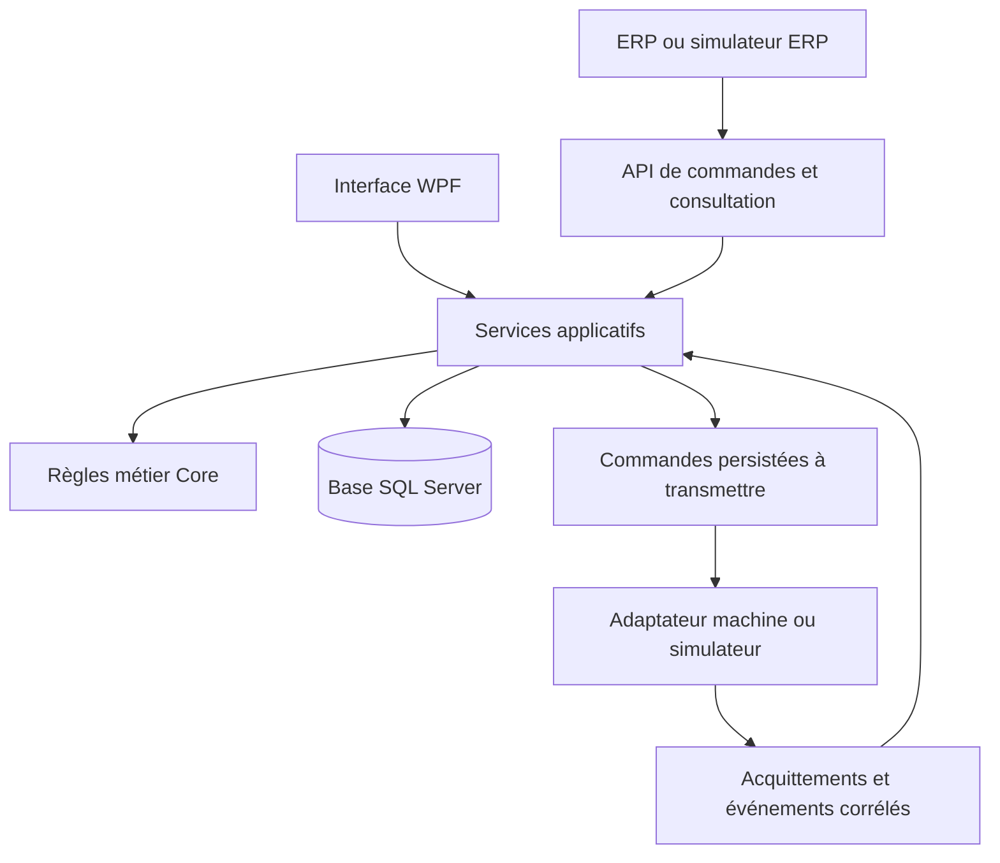

# TransportOrders : rapprochement technique avec MCVIS

Analyse des pages publiques consultées le 11 octobre 2026 et du code de ce dépôt.

**Évolution du 12 octobre 2026 :** le projet utilise maintenant un scénario d'extrusion aluminium,
un synoptique de stations et un simulateur de déplacements persistés. Voir le
[guide du scénario actuel](extrusion-scenario.fr.md). Le rapprochement ci-dessous conserve l'analyse
initiale de l'aciérie comme point de départ ; les propositions de positions et de simulation ont depuis
été partiellement réalisées. Les paniers, lots matière et emplacements disposent désormais de tables
propres ; positions et réservations sont sauvegardées avec les transports dans une même transaction.
La migration depuis le scénario précédent conserve les ordres et leur historique. Les équipements
possèdent désormais des modes et défauts persistants avec journal ; les fours exécutent des cycles
simulés par alliage avec chauffe, maintien et refroidissement avant autorisation de sortie. Les recettes
sont des exemples de démonstration. Les colis disposent désormais de contrôles, étiquettes textuelles
et mouvements propres ; les paniers sont déchargés, retournés à vide et réutilisables avec un numéro
de chargement distinct. Un ordonnanceur commun au simulateur, à l'interface et à l'API choisit désormais
les actions selon la disponibilité, la priorité, les échéances de transport et les charges compatibles.
Les transferts disposent d'une outbox, d'une inbox d'acquittements, d'identifiants stables et de reprises
bornées, testés avec un simulateur PLC persistant. Aucun protocole de machine réelle n'est connecté.
Les prévisions de production, les imprimantes, les stocks, SQL Server et les connexions automates
restent à développer.

## Sources et contexte

Les liens concernent **Walter Böhler Steuerungen GmbH, à Schwarzach**, fournisseur de solutions
d'automatisation. Le scénario d'aciérie de TransportOrders est un choix de démonstration du dépôt ;
il ne suffit pas à établir une relation avec cette entreprise ou avec ses installations.

| Source officielle | Ce qu'elle permet de comprendre |
| --- | --- |
| [Prozessleitsystem MCVIS](https://www.boehler.at/leistungsspektrum/prozessleitsystem-mcvis/) | Système modulaire de conduite et de visualisation, traçabilité, environnement Microsoft et interfaces vers ERP et automates. |
| [Software-Ingenieur .NET](https://www.boehler.at/stellenanzeige/software-ingenieur-net-m-w/) | Compétences demandées : C#, WPF, ASP.NET, réseaux et MS SQL Server ; développement, mise en service, réception, documentation et formation. |
| [Geschichte](https://www.boehler.at/unternehmen/geschichte/) | Origine de MCVIS en 1998 ; exemple Thöni en 2019 associant ordres de transport, automates, données de processus et visualisation des stocks. |
| [Extrusion-Lösungen](https://www.boehler.at/leistungsspektrum/extrusion-loesungen/) | Contexte industriel de l'extrusion aluminium, depuis la matière première jusqu'à l'expédition, avec installations neuves et rétrofits. |
| [Referenzprojekte](https://www.boehler.at/referenzen/referenzprojekte/) | Diversité des applications : logistique, convoyage, manutention, grues et conduite de procédés. Cette liste ne décrit pas l'architecture logicielle de chaque installation. |
| [Aktuelle News](https://www.boehler.at/news/aktuelle-news/) | Cas Hydro à Tönder : paniers de profilés, constitution de lots pour les fours, routage selon les étapes de fabrication et affectation aux postes d'emballage. |

La page MCVIS parle de produits Microsoft et de protocoles standardisés sans identifier toutes les
technologies internes. L'offre d'emploi confirme les compétences recherchées ; elle ne démontre pas
que chaque version de MCVIS utilise WPF, ASP.NET Core, EF Core ou .NET 8.
OPC UA reste ici une option d'intégration proposée, et non un protocole MCVIS confirmé par ces pages.

## Correspondances avec le code existant

Les rapprochements ci-dessous sont notre analyse du dépôt à la lumière des sources précédentes.

| Point technique | Preuve dans TransportOrders | Portée et écart à combler |
| --- | --- | --- |
| C# et séparation des responsabilités | Projets Core, Data, App et Api ; [TransportOrder](../src/TransportOrders.Core/TransportOrder.cs) | Le métier est séparé de l'interface et de la persistance. Une couche de services applicatifs faciliterait son utilisation par plusieurs clients. |
| Interface opérateur WPF | [MainViewModel](../src/TransportOrders.App/ViewModels/MainViewModel.cs), commandes MVVM, filtres, scan et localisation EN/DE | Démonstration directement pertinente pour le poste. L'écran reste une liste d'ordres ; il ne représente pas la position physique des charges. |
| ASP.NET | [OrderEndpoints](../src/TransportOrders.Api/OrderEndpoints.cs) | API de consultation et de calcul. Aucun ordre n'est importé depuis un ERP et aucune commande machine n'est envoyée. |
| Base de données | [AppDbContext](../src/TransportOrders.Data/AppDbContext.cs), migrations et [repository](../src/TransportOrders.Data/EfOrderRepository.cs) | Expérience relationnelle et EF Core démontrée avec SQLite. SQL Server, cité dans l'offre, reste à intégrer et tester. |
| Ordres et mouvements | [Transport](../src/TransportOrders.Core/Transport.cs), transitions Planned → InTransit → Done | Base d'un module de gestion des transports. Le départ et l'arrivée sont confirmés par l'opérateur, sans acquittement automate. |
| Planification | [LoadPlanner](../src/TransportOrders.Core/LoadPlanner.cs) | Regroupement par trajet, priorité, longueur et charge utile. Absence de réservation d'une machine, de gestion des files et de disponibilité des destinations. |
| Traçabilité | [StatusChange](../src/TransportOrders.Core/StatusChange.cs), [HeatGenealogy](../src/TransportOrders.Core/HeatGenealogy.cs) | Historique utilisateur/date/motif et filiation matière. Les paramètres de fabrication, mesures et recettes ne sont pas modélisés. |
| Exploitation et diagnostic | [ShiftSummary](../src/TransportOrders.Core/ShiftSummary.cs), logs Serilog, tests et CI | Bon support pour expliquer le comportement logiciel. Les alarmes machine, pertes de connexion et procédures de reprise restent à concevoir. |

La règle de remplissage à 90 %, les capacités des véhicules et les règles de blocage qualité sont des
choix de ce projet. Les sources ne permettent pas de les attribuer à MCVIS.

## Le cas concret le plus proche : Hydro à Tönder

L'article décrit MCVIS TLS coordonnant grues automatiques, shuttle et convoyeurs, avec visualisation
des emplacements et du contenu des paniers, et adaptation aux états des installations.
La date de publication de cet article n'est pas indiquée dans le texte consulté.
[Source : actualités Böhler](https://www.boehler.at/news/aktuelle-news/).

Pour rapprocher la démonstration de ce cas, voici une **proposition de modèle**, pas une description
des classes internes de MCVIS :

| Aujourd'hui | Extension proposée | Intérêt concret |
| --- | --- | --- |
| Une commande porte une pièce ou un ensemble de pièces | `HandlingUnit` / panier, avec contenu et identifiant propre | Suivre le contenant transporté indépendamment des commandes commerciales qu'il regroupe. |
| Source et destination sont des chaînes | `Location` avec capacité, occupation et réservation | Empêcher un départ vers un emplacement déjà occupé. |
| Un trajet relie deux stations | `ProcessRoute` et étapes de fabrication | Calculer la prochaine destination à partir de l'opération terminée. |
| `Vehicle` représente un type et ses capacités | `Equipment` identifié avec disponibilité et état | Affecter un mouvement à une ressource physique et éviter les affectations simultanées. |
| L'opérateur termine le transport | Événement d'arrivée corrélé à une commande | Mettre à jour le suivi à partir d'un retour machine vérifié. |

Passer à l'aluminium demanderait des données et des règles adaptées aux paniers, lots et étapes de
fabrication. Un simple changement des noms de stations ne reproduirait pas ce fonctionnement.

## Architecture d'évolution proposée

Ce schéma montre une cible pour **TransportOrders**, entièrement proposée ici.

Le service applicatif vérifierait les droits, l'état courant, les réservations et la version des données
avant d'enregistrer une décision. La commande à transmettre serait persistée dans la même transaction,
puis envoyée par un traitement séparé. Un identifiant stable permettrait de reconnaître les messages
répétés après une reconnexion. Un délai dépassé ne devrait pas être interprété comme une arrivée réussie.

## Étapes conseillées et critères de validation

Ces travaux sont proposés ; ils ne sont pas implémentés par l'ajout de cette documentation.

1. **Consolider les invariants actuels.** Rejeter les doublons lors de la fin d'un transport, valider
   l'utilisateur et les dates, détecter les cycles de filiation et clarifier la précision des longueurs.
   Ajouter des tests qui reproduisent chaque cas avant sa correction.
2. **Gérer plusieurs opérateurs.** Ajouter une version de concurrence, une attribution fiable des numéros
   et un message de conflit. Vérifier que deux sessions ne peuvent pas expédier le même ordre et qu'une
   ancienne vue ne peut pas écraser un blocage qualité. Le changement de base seul ne résout pas ce problème.
3. **Introduire SQL Server.** Préparer des migrations propres au fournisseur, préserver les données et
   tester les transactions, sauvegardes et restaurations avec cette base réelle.
4. **Ajouter un simulateur machine.** Introduire commande, acceptation, exécution, arrivée et échec.
   Tester les messages dupliqués, les retours hors ordre, la déconnexion et le redémarrage pendant un trajet.
5. **Modéliser les emplacements et ressources.** Réserver la destination et l'équipement avant l'envoi.
   Tester une destination pleine et une ressource indisponible, puis afficher leur état dans WPF.
6. **Préparer une réception démontrable.** Rédiger un scénario de démonstration, une procédure d'installation
   et un guide opérateur. Pour chaque scénario, documenter préconditions, action et résultat attendu.

## Comment présenter le projet

Présentation possible : « J'ai développé en C# une application WPF de gestion des transports internes,
avec règles de chargement, traçabilité, persistance EF Core et API ASP.NET Core. J'ai étudié les cas publics
de MCVIS pour identifier les extensions nécessaires : ressources physiques, emplacements, concurrence
et échanges fiables avec les automates. »

Les 104 tests existants ont réussi lors de l'analyse du dépôt le 11 octobre 2026. Ils constituent une
preuve de vérification du périmètre actuel, pas une validation d'intégration avec des équipements réels.
